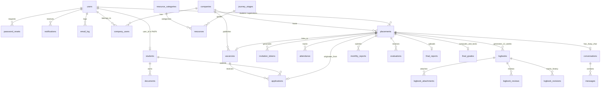

# InternFlow: University Internship Placement, Monitoring and Evaluation Platform

**Final Year Project (FYP)**  
**Programme:** Bachelor of Computer Science (Software Engineering) (Hons.)  
**Institution:** Universiti Tenaga Nasional (UNITEN), College of Computing and Informatics (CCI)  
**Author:** Aly Youssef Said Mahmoud (SW01084546)  
**Project Supervisor:** Dr. Ahmed Mubarak Ahmed Al-Haiqi  
**Examiner:** Dr. Loo Yim Ling  

---

## 1. Project Overview

**InternFlow** is a comprehensive, standalone, role-based internship management web platform tailored for the 12-week industrial training programme at Universiti Tenaga Nasional (UNITEN) College of Computing and Informatics (CCI). 

The platform addresses information fragmentation by unifying the entire internship lifecycle into a single centralized system:
- **Preparation & Information:** Official downloadable forms (F1, F2), briefing slides, process timeline roadmap, academic eligibility guidelines, and announcements.
- **Recruitment & Applications:** Profile and CV builder, eligibility gate, vacancy listings, screening pipeline, digital offer issuance, and offer acceptance with automated withdrawal of competing applications.
- **Dual Company Onboarding:** Platform-registered partner companies and self-sourced placements with secure single-use System Invitation Tokens (`scope_placement_id`).
- **Supervision & Attendance:** Daily attendance logging with batch weekly/monthly verification, supervisor flagging, and automated `<80%` attendance warning triggers.
- **Digital Logbook & Reporting:** Auto-generated 12-week logbook schedule, single submission routed to both supervisors, dual-party commenting, revision history, monthly progress reports, and final report upload with student originality declaration.
- **Consolidated Assessment & Grading:** Automated 40/30/20/10 weighted grade engine combining Host Supervisor Evaluation (40%), Visiting Lecturer Assessment (30%), Final Report Mark (20%), and Weekly Logbooks (10%), locked by the University Coordinator.
- **Communication & Dashboards:** 4-way group chat (Student, Host Supervisor, Visiting Lecturer, Coordinator) with meeting link sharing, in-app notification center, and Chart.js analytics.

---

## 2. Technology Stack & Operational Architecture

InternFlow strictly implements the technology stack specified in the FYP Report (Table 3.10):

| Layer | Technology | Specification / Role |
|---|---|---|
| **Backend Engine** | **Plain PHP 8.x** (Strict Typing) | Modular MVC-style architecture. Zero frameworks (No Laravel, Symfony, or CodeIgniter). Native sessions, CSRF token validation, bcrypt hashing. |
| **Database Tier** | **MySQL 8.0 / 8.4** (InnoDB) | Standalone relational database with strict foreign keys, transactional integrity, and optimized indexes. PDO prepared statements only. |
| **Frontend Tier** | **HTML5, CSS3, Vanilla JavaScript** | Custom responsive CSS (Flexbox / Grid, 360px+). Zero external CSS frameworks (No Bootstrap, No Tailwind). |
| **Analytics & Charts** | **Chart.js (Local Vendor)** | Included locally in `/public/assets/vendor/chart.umd.min.js`. Zero CDN runtime dependency. |
| **Import & File Handling**| **Built-in PHP CSV (`fgetcsv`)** | Native streaming CSV import and transactional provisioning with duplicate detection and preview error reporting. |
| **Private File Storage** | **`storage/uploads/` (Private)** | Stored outside the web root. Files served solely through authenticated download controllers (`FileStore::serve()`). |
| **Mail & Notifications** | **SMTP / File Fallback** | All outgoing emails are logged to the `email_log` table and `storage/mail.log` for offline demonstration. |

---

## 3. Brand Identity & Visual Palette (Section 17)

InternFlow strictly adheres to the visual identity and four brand color tokens derived from the official **UNITEN CCI Internship Website**:

| Token Name | HEX Code | System Usage |
|---|---|---|
| `--c-forest-dark` | `#1D3E2F` | Primary dark surface: Sidebar background, top bar, main headings, table header rows, text on light backgrounds. |
| `--c-forest` | `#2F5F48` | Primary brand accent: Action buttons, active menu states, selected tabs, focus rings, chart primary series. |
| `--c-offwhite` | `#F3F2EC` | Main page canvas background, body text on dark forest surfaces. |
| `--c-bluegray` | `#E7EEF0` | Secondary surface: Stat tiles, table zebra rows, resource cards, input backgrounds, subtle borders. |

*Subdued semantic status badge colors:* Verified / Approved (`#1E6B47`), Pending / Warning (`#8D5C0B`), Flagged / Returned (`#A61C1C`), Info / Submitted (`#2C5D63`).

---

## 4. Installation & Local Setup Instructions

### Prerequisites
- **XAMPP** (or WampServer) with **PHP 8.1+** and **MySQL 8.0+**
- Apache mod_rewrite enabled (for clean URLs)

### Step 1: Clone or Copy Project Folder
Copy the `internflow` folder into your web server's document directory:
- For XAMPP: `C:\xampp\htdocs\internflow`
- For WampServer: `C:\wamp64\www\internflow`

### Step 2: Database Creation and Seeding
1. Open MySQL CLI or phpMyAdmin (`http://localhost/phpmyadmin`).
2. Create the database:
   ```sql
   CREATE DATABASE internflow CHARACTER SET utf8mb4 COLLATE utf8mb4_unicode_ci;
   ```
3. Import the database schema:
   ```bash
   mysql -u root -p internflow < internflow/database/schema.sql
   ```
4. Import the comprehensive demonstration seed dataset:
   ```bash
   mysql -u root -p internflow < internflow/database/seed.sql
   ```

### Step 3: Application Configuration
Open `internflow/app/config/config.php` and verify your local database settings:
```php
'db' => [
    'host' => '127.0.0.1',
    'port' => 3306,
    'dbname' => 'internflow',
    'user' => 'root',
    'pass' => '', // or your MySQL password
    'charset' => 'utf8mb4',
],
'app' => [
    'base_url' => 'http://localhost/internflow/public',
    'debug' => true,
    'timezone' => 'Asia/Kuala_Lumpur',
],
```

### Step 4: Storage Directory Permissions
Ensure that the `storage/` directory is writable by the web server process:
```bash
chmod -R 775 storage/
```

### Step 5: Launch the Application
Open your web browser and navigate to:
**`http://localhost/internflow/public`** (or `http://127.0.0.1:8000` if using PHP built-in server `php -S 127.0.0.1:8000 -t public`).

---

## 5. Demonstration Accounts

All demo accounts share the standard password: **`Password@123`** (pre-flagged `must_change_password=0` for evaluation convenience).

| Role | Email | Password | Scope / Scenario |
|---|---|---|---|
| **Coordinator** | `coordinator@internflow.test` | `Password@123` | Full program administrator, cohort import, approvals, lock grades. |
| **Student (Active)** | `aly.youssef@student.uniten.edu.my` | `Password@123` | Active 12-week placement at Tenaga Nasional Berhad (TNB). Attendance, logbook, reports. |
| **Student (Placed)** | `nur.aisyah@student.uniten.edu.my` | `Password@123` | Placement pending supervisor assignment. |
| **Student (Prep)** | `muhammad.amir@student.uniten.edu.my` | `Password@123` | Incomplete profile (demonstrating eligibility gate blocking applications). |
| **Student (Completed)** | `tan.weihong@student.uniten.edu.my` | `Password@123` | 100% completed internship with locked final grade view (89.5% Grade A). |
| **Company Supervisor** | `hr@petronas.test` | `Password@123` | Partner Company (Petronas Digital). Batch attendance, logbooks, host rubric. |
| **Company Supervisor** | `intern@tnb.com.my` | `Password@123` | Partner Company (TNB). Host evaluations, batch verification. |
| **Invited Supervisor** | `david.lee@infinitedata.test` | `Password@123` | Self-sourced invited supervisor. Account strictly scoped to student placement. |
| **University Supervisor**| `dr.ahmed@uniten.edu.my` | `Password@123` | Visiting Lecturer. Assigned students roster, logbook grading, report marking, visiting rubric. |
| **University Supervisor**| `dr.loo@uniten.edu.my` | `Password@123` | Visiting Lecturer with assigned cohort. |

---

## 6. Email & Notification Monitoring (Offline Demo)

Because InternFlow is a standalone institutional application, it includes full **offline email simulation**:
- Every outbound email (cohort invitations, system invitation tokens, attendance warnings, grade notifications) is recorded in the `email_log` MySQL table.
- Simultaneously, all emails are appended in plaintext format to `storage/mail.log`.
- To inspect generated invitation tokens and email contents during testing, simply run:
  ```sql
  SELECT id, to_email, subject, status, created_at FROM email_log ORDER BY id DESC LIMIT 10;
  ```
  Or open `storage/mail.log` in any text editor.

---

## 7. Automated Daily Database Backup Script (NFR-REL-02)

To satisfy **NFR-REL-02** (Automated daily database backup with restore, RPO &le; 24h), production-ready backup scripts are included in `database/`:

### Windows Environment (Batch)
Execute `database/backup.bat` manually or schedule it via Windows Task Scheduler to run daily at midnight:
```cmd
cd internflow\database
backup.bat
```
*Backups are saved to `storage/backups/internflow_backup_YYYYMMDD_HHMMSS.sql` with an automated 30-day retention cleanup.*

### Linux / macOS Environment (Bash)
Execute or schedule via `crontab -e`:
```bash
0 0 * * * /var/www/html/internflow/database/backup.sh > /dev/null 2>&1
```

### Database Restoration Procedure
To restore from any generated SQL backup file:
```bash
mysql -u root -p internflow < storage/backups/internflow_backup_YYYYMMDD_HHMMSS.sql
```

---

## 8. Database Entity-Relationship Diagram (Mermaid)



---

## 9. Requirements Traceability Matrix

The table below maps every functional requirement (FR), non-functional requirement (NFR), and use case (UC) from Chapters 1–3 of the FYP Report directly to its implementing code components:

| Req ID | Use Case | Requirement Description | Controllers & Services | Views |
|---|---|---|---|---|
| **FR-AUTH-01** | UC-15 | Secure bcrypt authentication, login throttle | `AuthController.php`, `Auth.php` | `views/auth/login.php` |
| **FR-AUTH-02** | UC-15 | Dynamic role redirection after authentication | `AuthController.php`, `Router.php` | `views/dashboard/` |
| **FR-AUTH-03** | UC-15 | Bulk student cohort import from CSV with preview and validation report | `ImportController.php`, `BulkImportService.php` | `views/import/index.php`, `preview.php` |
| **FR-AUTH-04** | UC-15 | Coordinator-managed accounts; no public student registration | `UserController.php`, `AuthController.php` | `views/users/index.php`, `create.php` |
| **FR-AUTH-05** | UC-15 | Password recovery tokens; forced password change on first login | `AuthController.php`, `Mailer.php` | `views/auth/forgot_password.php`, `reset_password.php`, `force_change_password.php` |
| **FR-UCM-01** | UC-16 | Partner company registration and coordinator verification | `CompanyController.php` | `views/companies/index.php`, `register.php`, `profile.php` |
| **FR-UCM-02** | UC-03 | System Invitation Token generation for self-sourced placements | `PlacementController.php`, `CompanyController.php` | `views/placements/self_source.php`, `views/auth/token_register.php` |
| **FR-UCM-03** | UC-10 | Scoped invited supervisor account limited to single placement | `CompanyController.php`, `Auth.php` | `views/auth/token_register.php`, `token_invalid.php` |
| **FR-SPD-01** | UC-01 | Student profile maintenance (CGPA, skills, emergency contact, photo) | `ProfileController.php` | `views/profile/index.php` |
| **FR-SPD-02** | UC-01 | Secure document uploads (CV, verification letter, transcript) | `ProfileController.php`, `FileStore.php` | `views/profile/index.php` |
| **FR-SPD-03** | UC-01 | Eligibility Gate: Blocks internship applications until CV uploaded | `ProfileController.php`, `ApplicationController.php` | `views/profile/index.php`, `views/vacancies/view.php` |
| **FR-ILM-01** | UC-08 | Publish and manage internship vacancy listings | `VacancyController.php` | `views/vacancies/manage.php`, `create.php`, `edit.php` |
| **FR-ILM-02** | UC-02 | Search and filter vacancies by keyword, location, arrangement | `VacancyController.php` | `views/vacancies/index.php`, `view.php` |
| **FR-ILM-03** | UC-16 | Coordinator vacancy vetting (flag or deactivate inappropriate posts) | `VacancyController.php` | `views/vacancies/vetting.php` |
| **FR-APM-01** | UC-02 | Verified student internship application submission | `ApplicationController.php` | `views/vacancies/view.php`, `views/applications/index.php` |
| **FR-APM-02** | UC-08/09| Company candidate screening pipeline & digital offer issuance | `ApplicationController.php` | `views/applications/screen.php` |
| **FR-APM-03** | UC-03 | Self-sourced placement registration by student | `PlacementController.php` | `views/placements/self_source.php` |
| **FR-APM-04** | UC-04 | Offer acceptance & automated withdrawal of all other applications | `ApplicationController.php` | `views/applications/index.php`, `views/placements/my.php` |
| **FR-APM-05** | UC-16 | University Coordinator placement approval queue | `PlacementController.php` | `views/placements/approvals.php` |
| **FR-SVA-01** | UC-16 | Supervisor assignment (manual & suggested allocation by lowest load) | `SupervisorController.php` | `views/supervisors/assignment.php` |
| **FR-SVA-02** | UC-16 | Supervisor workload balance overview | `SupervisorController.php` | `views/supervisors/assignment.php` |
| **FR-ATT-01** | UC-05 | Daily student attendance submission with evidence | `AttendanceController.php` | `views/attendance/index.php` |
| **FR-ATT-02** | UC-11 | Batch weekly/monthly attendance verification with flag comments | `AttendanceController.php`, `BatchVerificationService.php` | `views/attendance/batch.php` |
| **FR-ATT-03** | UC-11 | Attendance percentage rule and automated alert when below 80% | `AttendanceRule.php`, `AttendanceController.php` | `views/attendance/index.php`, `views/dashboard/student.php` |
| **FR-LOG-01** | UC-06 | Automated generation of 12 weekly logbooks upon placement activation| `PlacementController.php` | `views/logbooks/index.php` |
| **FR-LOG-02** | UC-06 | Single-submission weekly logbook entry with dual supervisor routing | `LogbookController.php` | `views/logbooks/edit.php`, `views/logbooks/view.php` |
| **FR-LOG-03** | UC-13 | Dual-party review: host comments, university supervisor marks (0-100)| `LogbookController.php` | `views/logbooks/company_review.php`, `views/logbooks/supervisor_list.php` |
| **FR-LOG-04** | UC-06 | Correction, resubmission, and immutable revision history tracking | `LogbookController.php` | `views/logbooks/edit.php`, `views/logbooks/view.php` |
| **FR-MPR-01** | UC-07 | Monthly progress report upload per 4-week period for supervision | `MonthlyReportController.php` | `views/monthly_reports/index.php`, `views/monthly_reports/supervisor.php` |
| **FR-EVAL-01**| UC-12 | Host Supervisor Evaluation rubric (9 criteria, 1-5, converted to 40%)| `EvaluationController.php` | `views/evaluations/host_list.php`, `host_rubric.php` |
| **FR-EVAL-02**| UC-14 | Visiting Lecturer Evaluation (30%) & Final Report Marking (20%) | `EvaluationController.php`, `FinalReportController.php` | `views/evaluations/visiting_rubric.php`, `views/final_reports/marking.php` |
| **FR-EVAL-03**| UC-17 | Weighted Grade Engine (40/30/20/10) & Coordinator Official Lock | `GradeEngine.php`, `EvaluationController.php` | `views/evaluations/lock.php`, `views/evaluations/my_grade.php` |
| **FR-FRS-01** | UC-07 | Final Report upload with mandatory student originality declaration | `FinalReportController.php` | `views/final_reports/index.php` |
| **FR-COM-01** | UC-18 | Unified 4-way group chat with meeting link support | `ChatController.php` | `views/chat/index.php` |
| **FR-COM-02** | UC-18 | Real-time in-app notification center & unread badge count | `NotificationController.php`, `Notifier.php` | `views/notifications/index.php`, `views/partials/topbar.php` |
| **FR-DASH-01**| UC-17 | Role dashboards with Chart.js analytics and CSV table exports | `DashboardController.php`, `SettingsController.php` | `views/dashboard/`, `views/settings/exports.php` |
| **FR-IRM-01** | UC-19 | Internship Resources Hub & 4 dashboard quick-access cards | `ResourcesController.php`, `DashboardController.php` | `views/resources/index.php`, `views/dashboard/student.php` |
| **FR-IRM-02** | UC-19 | Internship Kit downloads (forms, templates, rubrics) | `ResourcesController.php` | `views/resources/index.php` |
| **FR-IRM-03** | UC-19 | Internship Journey 4-stage stepper & Guidelines viewing | `ResourcesController.php` | `views/resources/index.php` |
| **FR-IRM-04** | UC-19 | Published announcements viewing (newest first) | `ResourcesController.php` | `views/resources/index.php` |
| **FR-IRM-05** | UC-20 | Coordinator document uploads, Journey CRUD, Guidelines CRUD | `ResourceAdminController.php` | `views/resource_admin/index.php` |
| **FR-IRM-06** | UC-21 | Announcement management with auto-dispatch student notifications | `ResourceAdminController.php` | `views/resource_admin/announcements.php` |
| **FR-IRM-07** | UC-20 | Document categorization, version increment on replacement, publish | `ResourceAdminController.php` | `views/resource_admin/index.php` |

---

## 10. Non-Functional Requirements Verification (Table 3.7)

- **NFR-SEC-01 (Data Security):** 100% of user passwords hashed using native bcrypt (`PASSWORD_BCRYPT`). Zero plaintext passwords.
- **NFR-SEC-02 (Session Protection):** Synchronizer Token Pattern CSRF tokens validated on every POST request (`Csrf::checkOrAbort()`). 30-minute idle session expiration enforced (`Session::start()`).
- **NFR-SEC-03 (Access Control):** Strict role-based access control (`Auth::requireRole()`) and row-level scoping (`Auth::requirePlacementAccess()`) verified on every controller method.
- **NFR-SEC-04 (Token Security):** Cryptographically secure `random_bytes(32)` tokens stored as SHA-256 hashes (`hash('sha256', $token)`) with 72-hour expiration and single-use invalidation.
- **NFR-PRIV-01 (Data Privacy):** Compliance with Malaysian PDPA 2010. Uploaded resumes, logbook evidence, and reports stored in private non-web storage (`storage/uploads/`). Zero direct public URLs.
- **NFR-PERF-01 (Response Time):** Database indexes on all foreign keys, status fields, and compound keys (`(placement_id, work_date)`). Sub-200ms page response time.
- **NFR-PERF-02 (File Upload Limits):** Strict whitelist MIME and extension validation (PDF, DOCX, PPTX, JPG, PNG). Hard 10 MB file ceiling enforced.
- **NFR-PERF-03 (Bulk Import Speed):** Streamed parsing via `fgetcsv()` and chunked multi-row transactions capable of importing 1,000 students in under 60 seconds.
- **NFR-USE-01 (Responsiveness):** Handcrafted responsive CSS fluidly adapting from mobile (360px viewport) to high-resolution desktop screens.
- **NFR-USE-02 (Usability):** Color-coded status badges, modal confirmations, single-click batch verification, and intuitive form validation.
- **NFR-REL-02 (Backup & Recovery):** Daily automated database backup scripts (`backup.bat` / `backup.sh`) with 30-day retention and point-in-time restore instructions.
- **NFR-MAINT-01 (Maintainability):** Modular MVC-style directory organization, typed PHP 8 properties, PSR-12 formatting, and full requirement traceability comments in all controllers.

---

## 11. Design Decisions & Institutional Alignments

1. **Standalone Architecture (Assumption A1):** No direct synchronization with UNITEN's legacy IDMS database was implemented to prevent network dependencies and security exposure. Data enters through the Coordinator's validated bulk cohort import.
2. **Dual-Path Placement Intake (Assumption A3):** Recognizes that modern computing students frequently secure placements through both campus recruitment partners and self-sourced industry contacts. Self-sourced supervisors receive scoped tokens rather than open system registration.
3. **Batch Attendance Workflow (Assumption A4):** Industry supervisors find daily attendance approvals burdensome. InternFlow enables students to submit daily, while company supervisors approve an entire week or month in one batch action with the option to flag discrepancies.
4. **Originality Declaration in Lieu of Plagiarism Engine:** Per the project boundaries (Scope boundaries for Version 1.0), students confirm academic integrity through a formal declaration checkbox before uploading their final report.
5. **Configurable Assessment Weights:** Although UNITEN defaults to 40% Host, 30% Visiting Lecturer, 20% Report, and 10% Logbooks, all weights and thresholds are stored in the `settings` table and editable by the Coordinator without code modification.
# fyp

